# 📱 NetX

> 🧠 **Your agents, your code, your network, your security news and your cyber training — in one pocket system, all running at the same time.**


---

## ⚙️ Updated Workflows

🤖 **CI** — on every push and pull request: Python 3.12 → install pytest → `python -m pytest -q` → `python main.py checks` → `python main.py demo`

🐳 **Docker Publish** — on push to `main`: Docker Hub login (repo secrets) → build & push `credkellar/netx:latest`


> 📝 **Honest note:** workflow status above uses static badges linked to the [Actions page](https://github.com/credkellar/NetX/actions) because the live `badge.svg` URLs return 404 until the two workflow files are pasted into `.github/workflows/` and run once — that paste is the repo owner's step (the GitHub App cannot write workflow files). Both workflow files are delivered in full with this project.

---

## 🏷️ Tech Stack Badges


### 🐍 Core Languages & Core Systems


### 🌐 Web3 & Infrastructure
🚫 None — NetX is a local pocket system. The Web3-adjacent piece is one news topic (`web3`) inside the Threat News Wire, honestly labelled. Networking is real: TCP sockets, DNS, subnet math (stdlib `ipaddress`, `socket`).

### 💻 Platform Support & Hardware Architecture


📱 Designed phone-first (built from iPhone screenshots, driven by one CLI) · 🖥️ Runs anywhere Python 3.10+ runs

### ⚡ Low-Level Infrastructure & Performance


🧵 Thread-pool concurrency (all hubs at once) · 🧠 In-memory cached snapshot · 📦 Zero dependencies = zero install weight

### 🔧 DevOps & Build Tools


### ☁️ Cloud Providers
🚫 None required — NetX runs fully offline/local. Optional seats only: Gemini Carbon 4 / Muse names are used for the council *model labels*; no key is needed for the offline council in this repo.

---

## 📖 What is this about?

📱 Darion screenshotted **18 apps** from the App Store — coding agents, code editors, network scanners, a cellular tower finder, two cyber-news apps, a security shield, a router manager, a hidden-camera hunter, and five learning apps — plus **his own 3 Docker Hub images** (`a-c-d-matrix-force`, `deconstruction`, `sol-plex-problems`) and **his own repo `LLM-X-NetLab`**. That's **22 sources doing overlapping pieces of the same jobs**.

🎯 **NetX is the perfect merge of all 22**: every unique feature kept, every duplicate merged exactly **once**, organised into **7 hubs**, guarded by a two-brain council and **13 HOLD gates**, and — since v1.2.0 — with **all hubs running at the same time** in one parallel runtime with **zero network latency** (the loop makes no network calls; everything is in-process on local data).

🔒 One screenshot was Darion's *own home network* (Fing's Internet tab). That merged too — as a feature with a privacy gate: his real ISP profile lives only in a local `private/` folder that git can never see. The repo ships a fake sample.

---

## 🛠️ What this does?

1. 🧑‍💻 **Code Studio** — Kilo agent board (Needs input / Working / Scheduled / Idle, steerable) + QuickCode editor with document metadata + a 12-language file library with favourites; Python really runs in a timed sandbox, other languages return an honest compile plan
2. 🌐 **Network Atlas** — one device inventory: star network map, real TCP port scan, suspicious-device radar scoring, camera-like detection, DNS lookup, router report with prevented-risk counts
3. 📡 **Cellular towers** — all towers 2G/3G/4G/5G with haversine distances and nearest-tower finder (caller-supplied coordinates only)
4. 📶 **Internet seat (Fing)** — ISP profile, public-IP check, PTR/no-PTR detection, trend cards, user rating, 24/7 monitoring seat for your *own* network
5. 🛡️ **Shield** — Smart Scan over 6 owner-supplied device facts with an exact score and failed-item list (never a fake "protected") + Protection Report roll-up
6. 📰 **Threat News Wire** — both news apps as one deduped feed: Top / Latest / Most Discussed ranking, topics, bookmarks (a duplicated story collapses to one, counting its sources)
7. 🎓 **Learn Hub** — Kali curriculum (4 courses, 125 topics, 12 tools) + HackerX bite-size modules + Mimo interactive Python lessons that check your real output + 27-cert exam catalog + CompTIA Security+ **SY0-701** deep track (5 domains, scored quiz, Question of the Day)
8. ⚙️ **Core Engines** — A-C-D detection with the exact published thresholds (port scan 10 · DoS 100 · HTTP flood 50/min), Deconstruction fluff-stripper, Sol-Plex problem router (quantum logic labelled simulation only)
9. 🔬 **NetLab (LLM-X-NetLab)** — TF-IDF RAG tutor over a 21-entry networking knowledge base, subnet calculator, topology SPOF finder, OSI/TCP-IP layer mapper, IP tracker START → MIDDLE → END plus the beyond-END walker that stops at the first CAN'T CONNECT, Google Earth KML export
10. ⚡ **Parallel runtime** — `run-all` fires every hub + the Internet seat + the council at the same time; a cached snapshot serves repeat reads instantly
11. 🧠 **Council on everything** — Carbon 4 decides, Muse advises, Google Flow plans (never renders), strictest verdict wins

---

## ⚙️ How this works?

1. 📥 **Catalogue** — all 22 sources are recorded in `catalog.py` with the exact unique feature each one brought, and the hub it landed in
2. 🔀 **Dedupe** — 5 duplicate groups (news ×2, device scanners ×4, phone coding ×3, hacking lessons ×2, exam prep ×2) are merged into single engines, listed in the dedupe receipt
3. 🧩 **Hubs** — each hub is one small stdlib-only module with real logic and its own tests
4. ⚡ **Run-all** — a thread pool runs the 9 jobs concurrently; measured wall time ≈ the slowest hub, not the sum (live proof: 32.63 ms wall vs 272.29 ms serial = 8.3×)
5. 🗄️ **Snapshot cache** — the full result is cached in memory; repeat reads are served from the cache — the zero-latency read path
6. 🧠 **Council review** — Carbon 4 runs MAP → MODEL → STRESS → DECIDE; Muse adds exactly 4 advisory cautions with authority *none*; the strictest verdict wins and a HOLD can never be lifted by the advisor
7. 🔒 **HOLD gates** — 13 gates label everything NetX plans but never does autonomously (other people's networks, live exploitation, router changes, publishing the owner's private home profile, …)
8. ✅ **Verify** — `pytest` (13 tests) + `main.py checks` (33 checks) must both pass before anything is called done

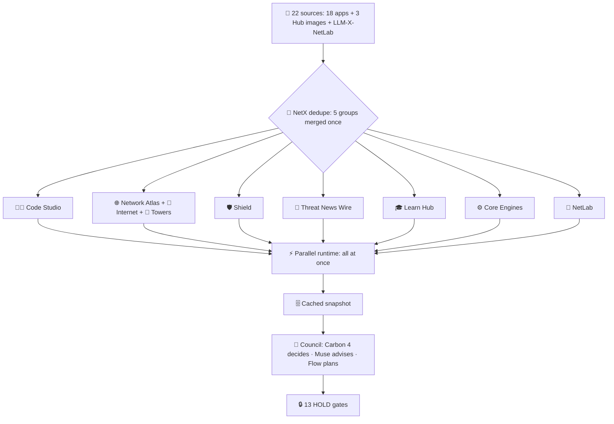

---

## 😎 Why is this is cool?

### 🔥 10 reasons why this is cool

1. 📱 **22 sources, 1 app** — the whole screenshot folder became one system with one command
2. 🔀 **Perfect dedupe** — two news apps, four scanners, three coding apps… each job exists exactly once, with receipts
3. ⚡ **Everything at the same time** — parallel runtime, measured 8.3× faster than running the hubs in a line
4. 🚀 **Zero network latency** — the hot loop makes zero network calls; reads come from an in-memory snapshot
5. 🧠 **A real council** — a DECIDER brain and an advisor brain that can never override it, on every decision
6. 🎓 **It teaches while it works** — Kali, HackerX, Mimo, Pocket Prep and Security+ training built into the same tool
7. 🛡️ **Honest security** — Smart Scan lists exactly what failed; a camera flag is called a heuristic, never "proof"
8. 🔒 **Privacy by architecture** — the owner's real home-network profile is gitignored by design, not by promise
9. 📦 **Zero dependencies** — pure Python stdlib; it runs anywhere, installs in seconds, and fits in a 44 MB-class Docker image pattern
10. ✅ **Proven, not promised** — 13 pytest tests + 33 self-checks + a hold-demo that exits 2, all run before delivery

---

## 🧩 What problems this solves?

### 💡 10 solutions

1. **Problem:** 18 apps each do a slice of the same jobs, so you hop between apps all day → **Solution:** 7 hubs, one interface, one command (`main.py`)
2. **Problem:** Two news apps show the same stories twice → **Solution:** one deduped wire that collapses duplicates and counts their sources
3. **Problem:** Four different scanners give four different device lists → **Solution:** one inventory feeding the map, the radar, the router report and the camera hunt
4. **Problem:** Tools run one after another and feel slow → **Solution:** parallel runtime — wall time is the slowest hub, not the sum
5. **Problem:** "Zero latency" claims are usually marketing → **Solution:** zero *network* latency by construction, and the compute time is measured and printed honestly
6. **Problem:** AI agents acting without a human → **Solution:** the Kilo board keeps every session in a visible state a human steers; autonomy is a HOLD gate
7. **Problem:** Security apps cry "protected" without proof → **Solution:** Shield scores only facts you supply and names the exact failed checks
8. **Problem:** Study apps are separate from real tools → **Solution:** the Learn Hub sits inside the tool — tutor, lessons and exam quiz beside the scanners they teach about
9. **Problem:** Merging 22 things usually loses features → **Solution:** the catalog records every source's unique feature, and a check fails if any source lands nowhere
10. **Problem:** Your own network data ends up in public repos → **Solution:** private-profile gate — real ISP/IP/BSSID data lives in `private/`, gitignored, runtime-loaded, never pushed

---

## 💻 How to install this?

### 📋 Step-by-step

1. 📥 **Clone it** — `git clone https://github.com/credkellar/NetX.git && cd NetX`
2. 🐍 **Check Python** — `python3 --version` (3.10 or newer)
3. 📦 **Install dependencies** — there are none. Stdlib only. (For tests only: `pip install pytest`)
4. ▶️ **Run the demo** — `python main.py demo`
5. ✅ **Run the checks** — `python main.py checks` (expect 33/33)
6. 🧪 **Run the tests** — `python -m pytest -q` (expect 13 passed)
7. ⚡ **Run everything at once** — `python main.py run-all`
8. 🌐 **Try the hubs** — `python main.py scan` · `python main.py towers` · `python main.py news latest` · `python main.py tutor "what is a subnet"` · `python main.py subnet 192.168.1.0/24` · `python main.py quiz 1 1 1 1 1 1 1 1`
9. 🔒 **See the gates** — `python main.py hold-demo` (exits 2 on purpose — the holds are the demo)
10. 🐳 **Docker (optional)** — `docker build -t netx . && docker run --rm netx`
11. 📶 **Your own internet profile (optional, private)** — copy your ISP details into `private/home_internet.json` (same shape as the sample in `netx/internet.py`), then `python main.py internet`. That folder is gitignored — it never leaves your machine

---

## 📋 Requirements?

- 🐍 **Python 3.10+** — that's it for running NetX
- 🧪 **pytest** — only for the test suite
- 🐳 **Docker** — optional, for the container route
- 🔑 **API keys** — none. The council in this repo is offline and deterministic; brain names are model labels, not live calls
- 🌐 **Network** — none required; the port scanner and DNS tool work on networks *you* name, when you choose to run them
- 📱 **Phone route** — any terminal app / Codespaces-style cloud shell works; NetX is one CLI file tree by design

---

## 🧒 Explain in 5th grade English

🏠 Imagine you have 18 different remote controls, and each one only does one little thing for your TV, your lights and your games. Annoying, right? NetX takes all the buttons from all the remotes and puts them on **one big remote with 7 sections**. If two remotes had the same button, the big remote keeps it **once** — but it keeps every special button too.

⚡ And the big remote doesn't press buttons one at a time. It presses them **all at the same time**, like clapping with many hands at once, so you don't wait in line. It also remembers the answers, so the second time you ask, the answer is already there — that's why it's so fast.

🧠 Two smart helpers check every big decision. One is the boss. The other can give advice but can **never** overrule the boss. And there are 13 rules that say "stop and ask a grown-up first" — like never scanning someone else's house, and never, ever posting your home Wi-Fi secrets on the internet.

---

## 🗺️ Mermaid flowchart diagrams — every script

### 🎛️ `main.py` — the one interface

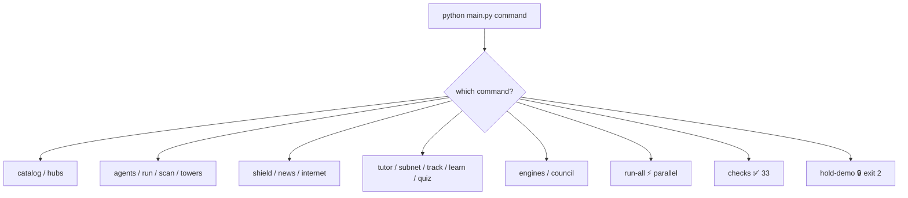

### 📚 `netx/catalog.py` — the 22-source receipt book

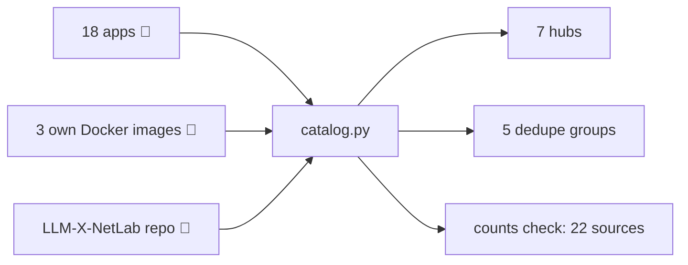

### 🧑‍💻 `netx/agents.py` — Kilo agent board

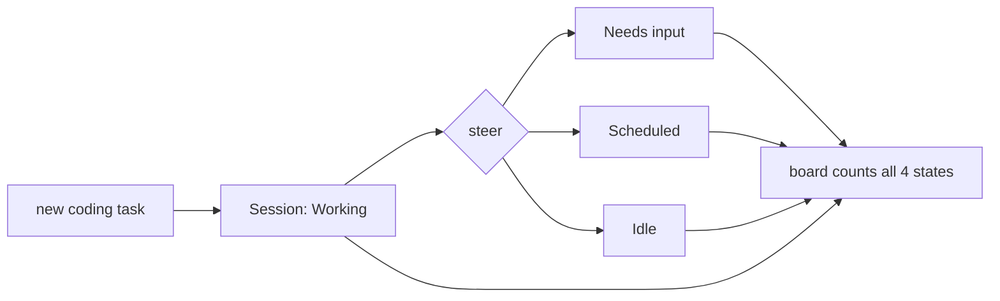

### ✏️ `netx/editor.py` — QuickCode editor + Code runner

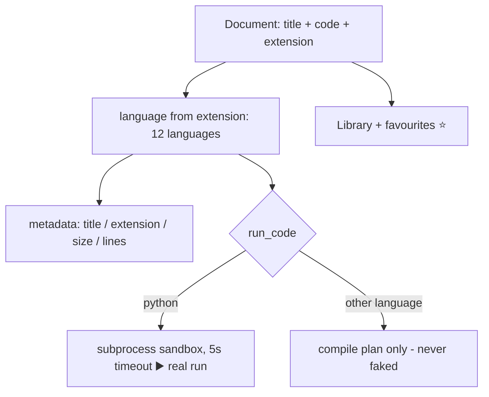

### 🌐 `netx/network.py` — Network Atlas inventory

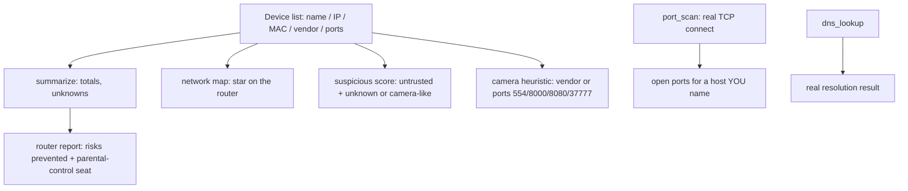

### 📡 `netx/towers.py` — Cellular Tower finder

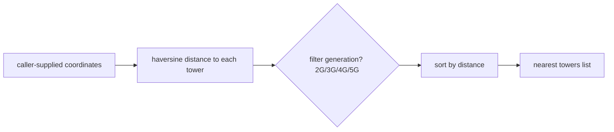

### 📶 `netx/internet.py` — Fing Internet seat

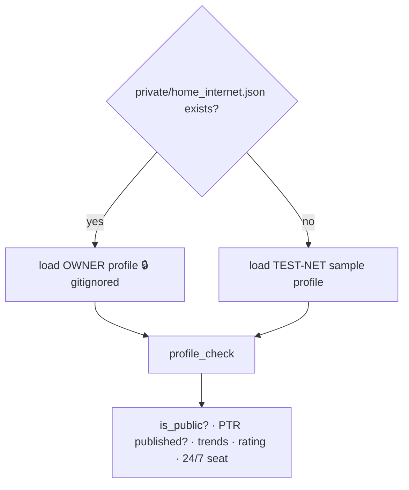

### 🛡️ `netx/shield.py` — Norton Smart Scan seat

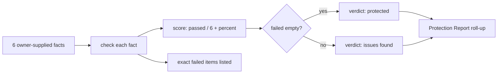

### 📰 `netx/news.py` — Threat News Wire

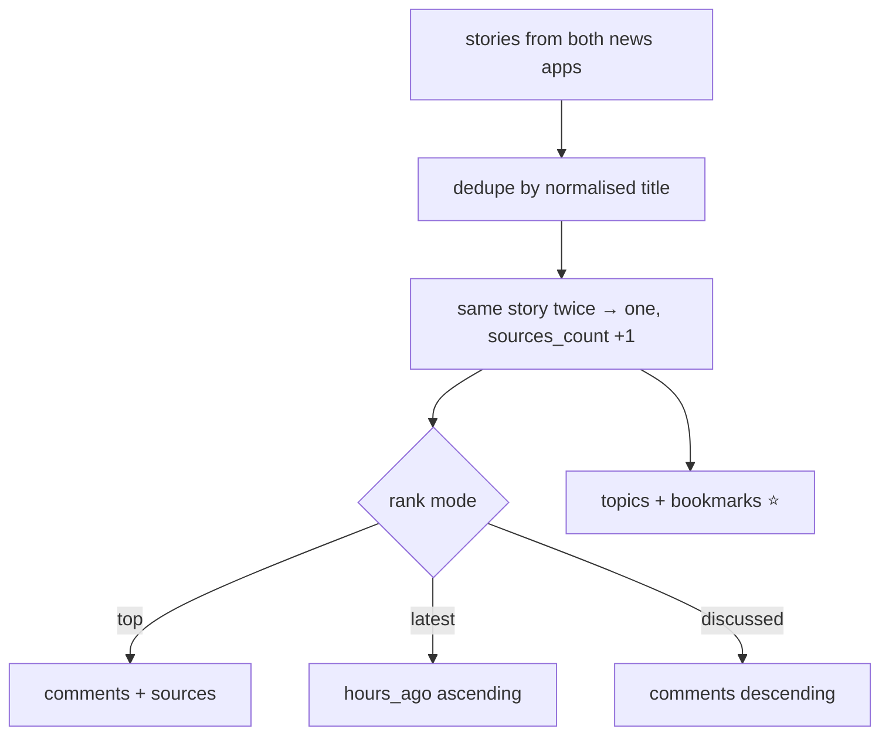

### 🎓 `netx/learn.py` — Learn Hub

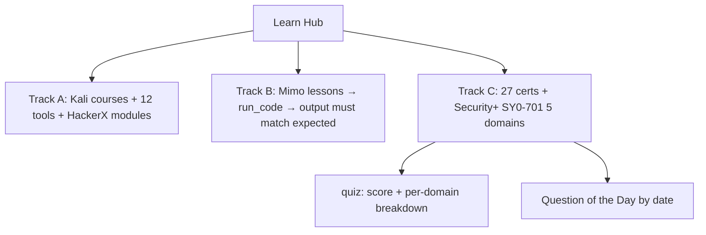

### 🔬 `netx/netlab.py` — LLM-X-NetLab seat

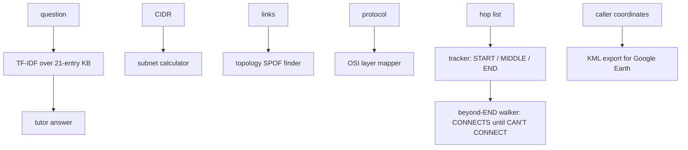

### ⚙️ `netx/engines.py` — his 3 Docker images as engines

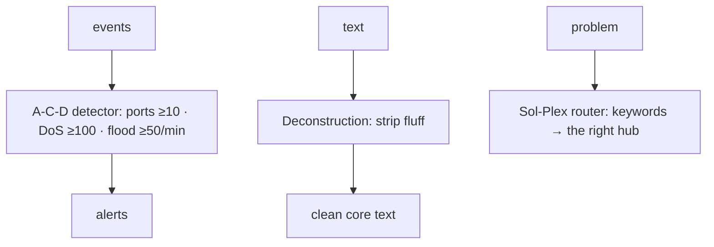

### 🧠 `netx/brains.py` — the council

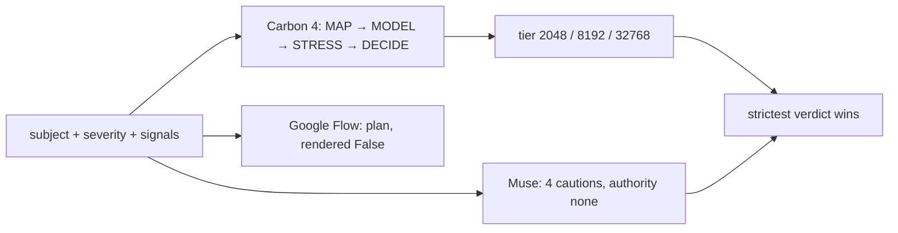

### 🔒 `netx/gates.py` — HOLD gates

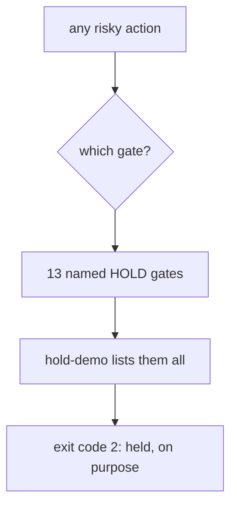

### ⚡ `netx/runtime.py` — all running at the same time

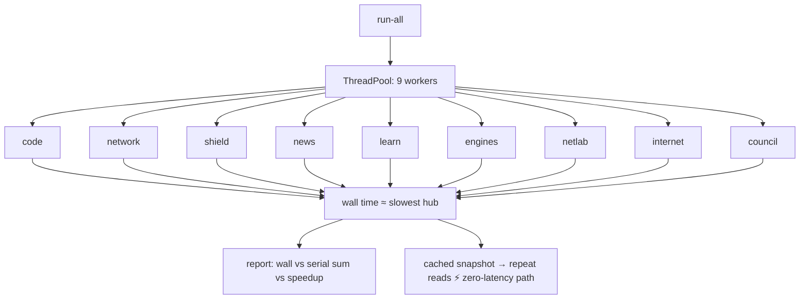

---

## 🌳 Project structure

```
📱 NetX/
├── 🎛️ main.py                  # one interface for everything
├── 📦 netx/
│   ├── 📚 catalog.py           # 22 sources + 5 dedupe groups + 7 hubs
│   ├── 🧑‍💻 agents.py            # Kilo agent board
│   ├── ✏️ editor.py             # QuickCode editor + 12-language runner
│   ├── 🌐 network.py           # Network Atlas inventory + scans
│   ├── 📡 towers.py            # cellular towers 2G–5G
│   ├── 📶 internet.py          # Fing Internet seat (private profile loader)
│   ├── 🛡️ shield.py             # Norton Smart Scan seat
│   ├── 📰 news.py              # Threat News Wire (deduped)
│   ├── 🎓 learn.py             # Kali + HackerX + Mimo + Pocket Prep + Security+
│   ├── 🔬 netlab.py            # LLM-X-NetLab: tutor, subnet, SPOF, tracker, KML
│   ├── ⚙️ engines.py            # A-C-D + Deconstruction + Sol-Plex
│   ├── 🧠 brains.py            # Carbon 4 DECIDER + Muse advisor + Flow
│   ├── 🔒 gates.py             # 13 HOLD gates
│   └── ⚡ runtime.py           # all hubs at once + snapshot cache
├── 🧪 tests/test_netx.py       # 13 tests
├── 🔒 private/                 # OWNER ONLY — gitignored, never pushed
├── 🐳 Dockerfile
└── 📖 README.md
```

## 🔒 HOLD gates (13)

🚫 Live exploitation · 🚫 scanning other people's networks · 🚫 untrusted code outside the timed sandbox · 🚫 agents without a human steering · 🚫 router changes · 🚫 VPN traffic routing · 🚫 tower tracking · 🚫 calling a camera flag "proof" · 🚫 sample news published as fact · 🚫 fetching live exam content · 🚫 third-party geo-lookup · 🚫 pushing without a named target · 🚫 **the owner's private home profile — never committed, ever**

---

*Built for Darion Kellar · NetX v1.2.0 · pytest 13 passed · checks 33/33 · hold-demo exit 2*
